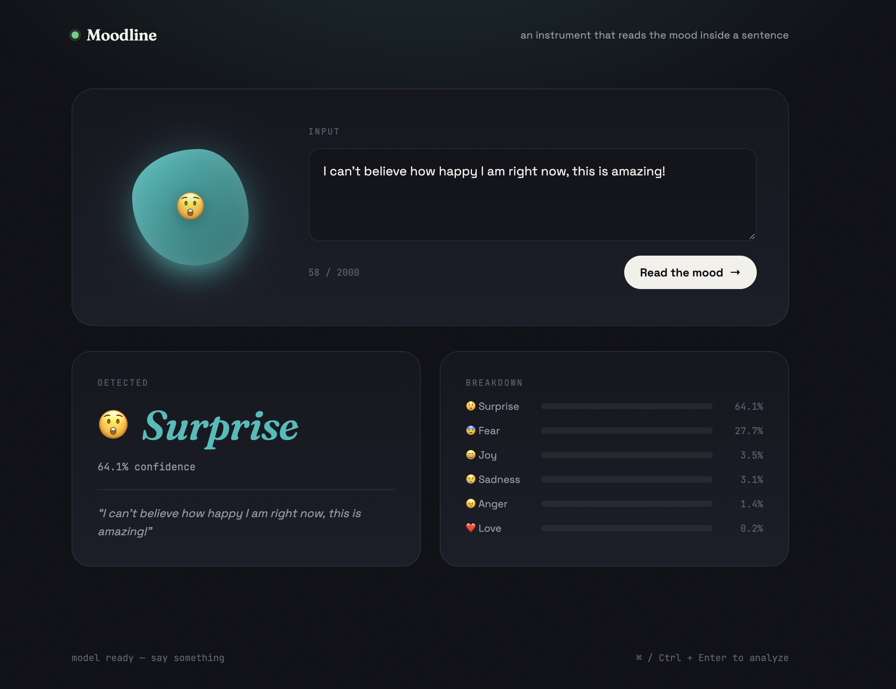
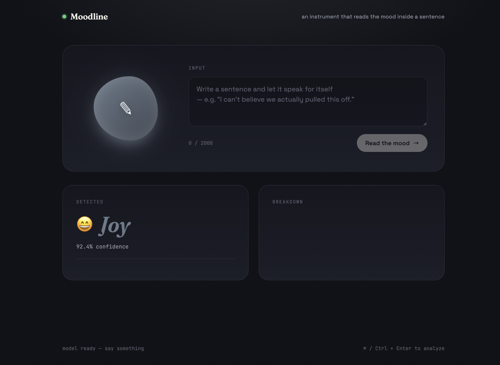
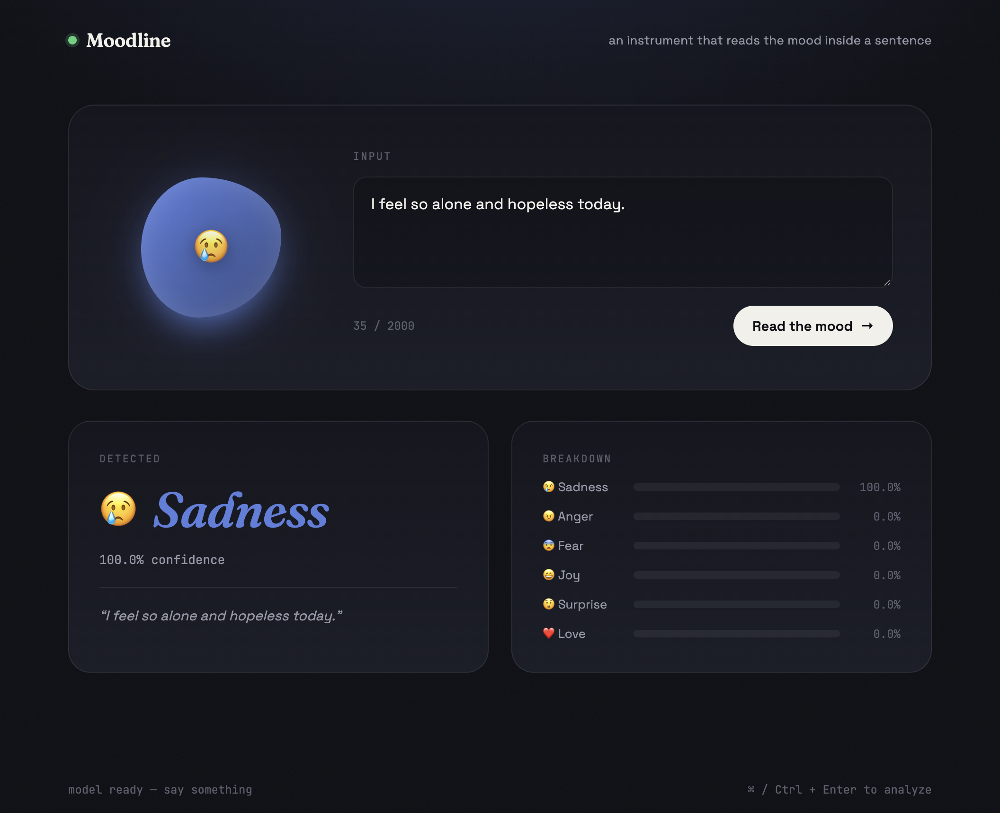

# Moodline — Emotion Detection Using Deep Learning

<p align="center">
  
</p>

<h3 align="center">
  An instrument that reads the mood inside a sentence.
</h3>

<p align="center">
  A deep learning-powered text emotion classification system built with TensorFlow, Keras, and FastAPI.
</p>

<p align="center">
  
  
  
  
  
</p>

---

## Overview

**Moodline** is a text-based emotion detection application that identifies the emotional tone of a sentence using deep learning.

It analyzes user-provided text and predicts one of six emotion categories:

- Joy
- Sadness
- Love
- Anger
- Fear
- Surprise

The project explores and compares multiple Recurrent Neural Network (RNN) architectures, including Simple RNN, LSTM, GRU, and Bidirectional GRU (BiGRU).

The trained BiGRU model is integrated into a FastAPI application to provide real-time emotion predictions through a web interface and REST API.

## Live Demo

> Deployment is currently being prepared.

---

## Application Screenshots

### 1. Moodline — Main Interface

The initial interface allows users to enter a sentence for emotion analysis.

<p align="center">
  
</p>

### 2. Surprise Detection

Example input:

> I can't believe how happy I am right now, this is amazing!

<p align="center">
  
</p>

The model predicts **Surprise** with a confidence score displayed in the interface.

### 3. Sadness Detection

Example input:

> I feel so alone and hopeless today.

<p align="center">
  
</p>

The model predicts **Sadness** and displays the confidence distribution across all six emotion categories.

---

## Emotion Categories

| Emotion | Description | Emoji |
|---|---|---|
| Joy | Happiness, excitement, and delight | 😁 |
| Sadness | Unhappiness, loneliness, and disappointment | 😢 |
| Love | Affection, care, and attachment | ❤️ |
| Anger | Frustration, irritation, and rage | 😠 |
| Fear | Anxiety, worry, and uncertainty | 😨 |
| Surprise | Unexpected or astonishing experiences | 😲 |

---

## Dataset

This project uses the **[DAIR.AI Emotion Dataset](https://huggingface.co/datasets/dair-ai/emotion)** from Hugging Face.

The dataset contains English text samples annotated with six emotion labels.

The dataset is used for:

- Text preprocessing
- Tokenization
- Sequence padding
- Model training
- Model evaluation

---

## Deep Learning Architectures

Four recurrent neural network architectures are implemented and evaluated.

| Architecture | Description |
|---|---|
| Simple RNN | Basic recurrent neural network |
| LSTM | Long Short-Term Memory |
| GRU | Gated Recurrent Unit |
| BiGRU | Bidirectional Gated Recurrent Unit |

### Final Model: Bidirectional GRU

The final prediction system uses a stacked Bidirectional GRU architecture.

The model processes sequences in both forward and backward directions to capture contextual information from the input text.

**Model configuration:**

| Parameter | Value |
|---|---|
| Embedding Dimension | 300 |
| Maximum Sequence Length | 50 |
| First BiGRU Layer | 128 Units |
| Second BiGRU Layer | 64 Units |
| Dropout | 0.5 |
| Output Classes | 6 |
| Activation Function | Softmax |
| Optimizer | Adam |
| Loss Function | Sparse Categorical Crossentropy |
| Early Stopping | Patience = 10 |

---

## How It Works

The application follows this prediction pipeline:

```text
             User Input
                 |
                 v
          Text Preprocessing
                 |
                 v
             Tokenization
                 |
                 v
            Sequence Padding
                 |
                 v
          Trained BiGRU Model
                 |
                 v
          Softmax Probabilities
                 |
                 v
          Emotion Classification
                 |
                 v
        Prediction + Confidence
```

The model generates probability scores for all six emotion categories. The category with the highest predicted probability is displayed as the detected emotion.

---

## Key Features

- Six-class emotion classification.
- Multiple RNN architecture implementations.
- BiGRU-based emotion prediction.
- Confidence score for the predicted emotion.
- Probability breakdown for all emotion categories.
- Interactive and responsive dark-themed user interface.
- FastAPI-powered backend.
- REST API for emotion prediction.
- Docker support for containerized deployment.

---

## Technology Stack

| Category | Technologies |
|---|---|
| Programming Language | Python |
| Deep Learning | TensorFlow, Keras |
| NLP | Tokenization, Sequence Padding |
| Data Processing | NumPy, Pandas |
| Data Visualization | Matplotlib, Seaborn |
| Model Evaluation | Scikit-learn |
| Backend | FastAPI |
| Frontend | HTML, CSS, JavaScript |
| Model Storage | Keras, Pickle |
| Deployment | Docker |

---

## Project Structure

```text
Sentiment_analysis/
│
├── Artifacts/
│   ├── BiGRU_Modle.keras
│   └── tokenizer.pkl
│
├── static/
│   ├── index.html
│   ├── style.css
│   └── script.js
│
├── docs/
│   └── screenshots/
│       ├── moodline-home.png
│       ├── moodline-surprise.png
│       └── moodline-sadness.png
│
├── Emotion_detection.ipynb
├── main.py
├── requirements.txt
├── Dockerfile
├── .dockerignore
├── .gitignore
└── README.md
```

> Update the artifact filenames and frontend filenames above if they differ in your repository.

---

## Installation and Setup

### 1. Clone the Repository

```bash
git clone https://github.com/YOUR_USERNAME/YOUR_REPOSITORY.git
```

```bash
cd YOUR_REPOSITORY
```

### 2. Create a Virtual Environment

```bash
python -m venv venv
```

Activate the environment.

**macOS / Linux**

```bash
source venv/bin/activate
```

**Windows**

```bash
venv\Scripts\activate
```

### 3. Install Dependencies

```bash
pip install -r requirements.txt
```

### 4. Run the Application

```bash
uvicorn main:app --reload
```

### 5. Open the Application

Web Interface:

```text
http://127.0.0.1:8000/
```

FastAPI Swagger Documentation:

```text
http://127.0.0.1:8000/docs
```

---

## API Usage

The FastAPI backend provides an endpoint for emotion prediction.

### Predict Emotion

**Endpoint**

```http
POST /predict
```

**Example Request**

```json
{
  "text": "I feel so happy and excited today!"
}
```

**Example Response**

```json
{
  "text": "I feel so happy and excited today!",
  "predicted_emotion": "joy",
  "confidence": 0.95
}
```

> This response is illustrative. Actual response fields and confidence values depend on the implementation and model output.

---

## Docker Deployment

Build the Docker image:

```bash
docker build -t moodline .
```

Run the container:

```bash
docker run -p 8000:8000 moodline
```

Open the application:

```text
http://localhost:8000/
```

---

## Model Evaluation

The notebook includes model evaluation and comparison using:

- Test accuracy
- Test loss
- Confusion matrix
- Normalized confusion matrix
- Architecture comparison

Actual evaluation metrics should be added here after running the final evaluation.

---

## Future Improvements

- Experiment with Transformer-based models such as BERT.
- Improve generalization across different writing styles.
- Add multilingual emotion detection.
- Perform hyperparameter optimization.
- Explore model quantization and compression.
- Improve inference speed and deployment efficiency.
- Expand the dataset with more diverse text samples.

---

## Limitations

- The model is trained for English text classification.
- Predictions depend on the quality and context of the input sentence.
- Emotion classification is not always definitive; a sentence may express multiple emotions.
- Model confidence is not a guarantee that the predicted emotion is correct.

---

## Author

**Md. Ahanaf Tahmid **

Computer Science and Engineering Graduate

- GitHub: [@rifat9754](https://github.com/rifat9754)

---

<p align="center">
  <b>Moodline</b>
  <br/>
  Reading the mood behind the words.
</p>
